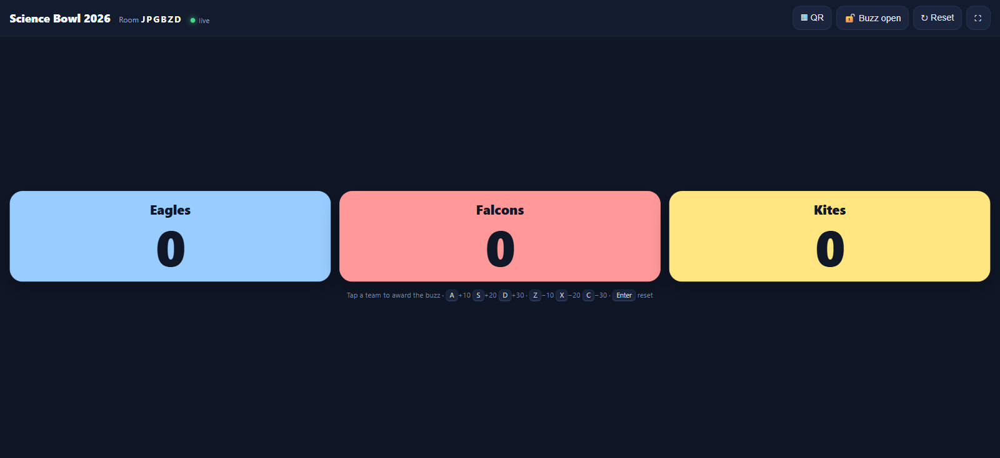
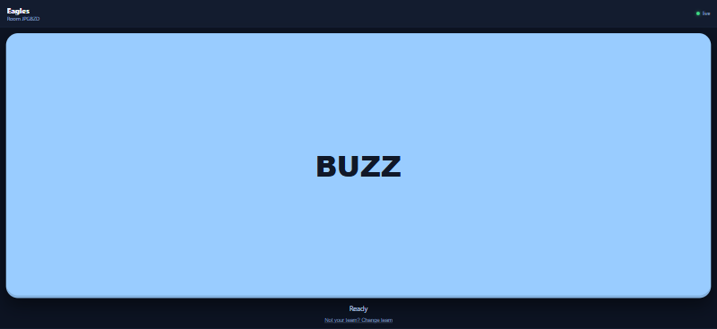

# QuizWare

Free, open-source browser-based quiz buzzer system.

One laptop runs the **host screen** (projector). It shows teams, scores and a QR code per team.
Players scan with their phones, get **one big BUZZ button**, and the first buzz that reaches the
server wins the round. The host can also award a buzz manually, lock buzzing for compulsory
questions, and change scores from the keyboard.

No app install, no dedicated hardware, no database.

| Host screen (projector) | Player phone |
|---|---|
|  |  |

## Run with Docker

```bash
docker run -d --name quizware -p 6743:6743 --restart unless-stopped \
  ghcr.io/osyan/quizware:latest
```

or from source:

```bash
git clone https://github.com/osyan/quizware.git
cd quizware
docker compose up -d --build
```

Then open <http://localhost:6743>. Full hosting options — Nginx/Cloudflare, LAN-only classroom
mode, Raspberry Pi, systemd, env vars, troubleshooting — are in **[SELFHOST.md](SELFHOST.md)**.

## Quick start (local, without Docker)

Requires Node.js 18 or newer.

```bash
npm install
npm start
```

On Windows you can also just double-click `start.cmd`, which uses the portable Node.js copy in
`%USERPROFILE%\tools\node` if it exists, installs dependencies on first run, and starts the server.

Then open <http://localhost:6743>:

1. **Create a room** → set title + teams → *Create room & open host screen*.
2. The host screen opens with a host key in the URL. Put it on the projector (⛶ for fullscreen).
3. Press **▦ QR** to show per-team QR codes. Players scan, pick their team, and get the BUZZ button.
4. Players can buzz. Fastest buzz (server arrival order) lights up the team and plays a beep.
5. Host scores with `A`/`S`/`D` (+10/+20/+30), `Z`/`X`/`C` (−10/−20/−30), `Enter` to reset.

Other devices on the same Wi-Fi can join too — use the machine's LAN IP, e.g.
`http://192.168.1.20:6743/config.html`.

## Pages

| Page | Who | Purpose |
|------|-----|---------|
| `index.html` | everyone | landing page: create a room or join by code |
| `config.html` | host | quiz title, number of teams, names, colours; creates the room |
| `host.html?session=…&key=…` | host / projector | scores, buzz winner, QR codes, buzz lock, keyboard scoring |
| `player.html?session=…&teamId=…` | players | one BUZZ button; also supports joining by code and picking a team |

## How a round works

1. Host resets (or it is a fresh round) → all player buttons enabled.
2. A player taps BUZZ → `buzz` event → the **first valid event** sets `currentWinner`.
3. Every device gets `sessionState` + `winner`; the host beeps once and shows the elapsed time.
4. Further buzzes are rejected (`reason: "closed"`), so no double winners.
5. Host scores the winner, then presses `Enter` to clear the buzz and open the next round.
6. **🔒 Buzz locked** makes the server ignore player buzzes (compulsory questions). Host
   force-buzz still works.

Fairness: the winner is decided by server arrival order, not by phone clocks. On a normal
school Wi-Fi this is accurate to well under the visible 0.01 s display, though a device with a
bad connection can be a few tens of milliseconds late.

## Security model

- Creating a room returns a **host key** (`key=…` in the host URL).
- Only sockets that present the correct key can score, reset or force-buzz.
- Player QR codes contain the session id and team id only — a player cannot take over the host screen.
- The host URL is the secret. Do not show the host screen with the address bar visible if the room
  must be tamper-proof; keep the link to yourself.
- Rooms live in memory and expire after 24 hours (or on restart).

## Project layout

```
quizware/
├── server.js            # Express + Socket.IO, in-memory sessions
├── package.json
├── Dockerfile           # multi-stage, non-root, healthcheck
├── docker-compose.yml   # restart policy, read-only rootfs, limits
├── public/
│   ├── index.html       # landing / join by code
│   ├── config.html      # create room
│   ├── host.html        # host control screen
│   └── player.html      # player buzz page
├── deploy/              # nginx vhosts, systemd unit, install-debian.sh
├── docs/                # screenshots
├── test/smoke.js        # end-to-end test (npm test)
├── .github/workflows/   # CI (tests + image build) and GHCR publish on tags
├── SELFHOST.md          # Docker / VPS / LAN / systemd guide
└── QUIZWARE_LOGIC.md    # full logic / deployment notes
```

`public/` is the web root, so every URL in the pages is relative — the app works both at
`http://localhost:6743/` and behind the `/quizware/` Nginx prefix.

## HTTP / socket API

| Endpoint | Purpose |
|----------|---------|
| `POST /api/session` | create a room: `{ title, teams:[{name,color}] }` → `{ session, hostKey }` |
| `GET /api/session/:id` | public room snapshot (never includes `hostKey`) |
| `GET /api/qr?text=…` | PNG QR code (used for team joins and the host link) |
| `GET /api/health` | liveness probe |

Socket events are documented in [QUIZWARE_LOGIC.md](QUIZWARE_LOGIC.md).

## Tests

```bash
npm start            # terminal 1
npm test             # terminal 2
```

The smoke test creates a room, verifies host-key auth, joins three players, checks
first-buzz-wins and late-buzz rejection, scoring, buzz lock, force-buzz, reset, the QR endpoint
and that all pages are served.

## Deploy

Three supported ways, all documented in [SELFHOST.md](SELFHOST.md):

- **Debian/Ubuntu server** — copy the folder, then
  `sudo bash deploy/install-debian.sh --domain quizware.syss.hk` (installs Docker if needed,
  builds, starts, waits for health, optionally installs the Nginx vhost),
- `docker compose up -d --build` on any machine with Docker,
- `docker run` with the published image from GHCR,
- bare metal: `npm ci --omit=dev` + [`deploy/quizware.service`](deploy/quizware.service).

For the public demo at `quizware.syss.hk`, use
[`deploy/nginx-quizware.syss.hk.conf`](deploy/nginx-quizware.syss.hk.conf), set `TRUST_PROXY=1`,
and keep Cloudflare WebSockets enabled.

### If the site returns 502

`502 Bad Gateway` means the proxy is up but the app is not answering:

```bash
docker ps -a && docker logs --tail 50 quizware
curl -sS http://127.0.0.1:6743/api/health
# bare metal instead:
systemctl status quizware --no-pager -l
journalctl -u quizware -n 50 --no-pager
```

Common causes: container stopped after reboot (needs `--restart unless-stopped`), a crash on
start (missing `node_modules`, wrong `WorkingDirectory`), or `proxy_pass` pointing at a stale IP
(prefer `127.0.0.1`).

## License

MIT — see [LICENSE](LICENSE). Free to self-host, modify and redistribute; attribution is enough.
If you would rather require modifications to stay open (copyleft), swap in AGPL-3.0 — nothing in
the code depends on the license choice.
